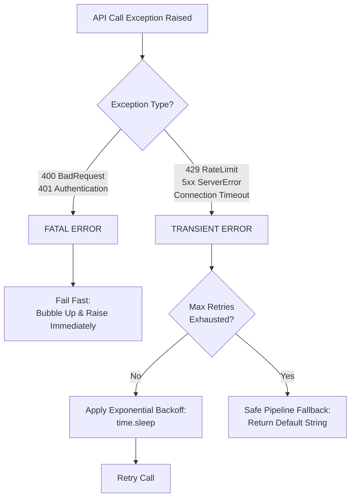

# Unit Testing

## The Metaphor: The Hollywood Stunt Double

Think of the real `anthropic.Anthropic()` client as an expensive Hollywood action movie star. You don't want to risk hurting them (or spending your entire budget) just to practice filming a basic driving scene.

Instead, you bring in a Stunt Double (the mock_instance).
• The director (pytest) yells "Action!"
• Your code treats the stunt double exactly like the movie star.
• The stunt double handles the scene perfectly, safely, and for free.

## The Biggest Takeaway

> Isolate your code's logic from your code's dependencies.

When writing unit tests, your goal is to test your code, not Anthropic's servers, your internet connection, or the remote API's uptime.

By replacing the external API with a predictable mock, you gain absolute control over the testing environment:

1. **Deterministic Outcomes:** You can force the mock to instantly return a perfect classification or force it to trigger a RateLimitError to see how your code responds.

2. **Infinite Safety Gate:** You can test code changes 10,000 times on a continuous integration (CI) server without spending a single penny on token costs or worrying about exposing production API keys.

3. **Speed:** Mocked tests execute locally in milliseconds because they eliminate real network latency over the internet.


> **Note:** The following code is for reference. All executable files are in `irl_examples/02_software_engineering_foundations/integration_mocking`.
> 
> Jump to [Part 5](#part-5-script-execution-routes) for instructions on how to use scripts.
---

## Anthropic API Integration: Robust Code Triage and Mock Testing Guide

This guide provides a comprehensive walkthrough for building a budget-capped, error-resilient classification pipeline using the Anthropic Python SDK. It covers both a ticket triager (using Haiku) and a code review assistant (using Sonnet), followed by an offline testing suite.

---

### Part 1: The Three-Step Environment Setup

#### Step 1: Create a Clean Sandbox Directory
Open your terminal and create a dedicated folder to safely isolate your dependencies and code assets.
```bash
mkdir -p anthropic_triage_sandbox/tests
cd anthropic_triage_sandbox
```

#### Step 2: Set Up and Activate a Python Virtual Environment
Isolate your Python runtime environment to avoid conflicts with global system packages.
```bash
python3 -m venv .venv
source .venv/bin/activate
```

#### Step 3: Install Required Dependencies
Install the official Anthropic API client along with `pytest` for executing your local test suites.
```bash
pip install --upgrade pip
pip install anthropic pytest
```

---

### Part 2: Core Implementation (The Two Classes)

Save the following code inside a file named **`triager.py`** in your root directory. This contains both `TicketTriager` and `CodeReviewTriager`, implementing robust token pricing tracking and explicit budget protection.

```python
# triager.py
import time
import anthropic

class BudgetExceededError(Exception):
    """Custom exception raised when an instance exhausts its allocated budget."""
    pass

class TicketTriager:
    def __init__(self, model_key: str, budget_usd: float):
        """
        Manages ticket classification using custom pricing matrices.
        Tracks spend and call counts independently per instance.
        """
        self.model_key = model_key
        self.budget_usd = budget_usd
        self.spent_usd = 0.0
        self.call_count = 0
        self.client = anthropic.Anthropic()
        
        # Determine pricing model rates dynamically ($1.00/$5.00 for Haiku 4.5)
        if "haiku-4-5" in model_key:
            self.input_rate = 1.00 / 1_000_000
            self.output_rate = 5.00 / 1_000_000
        else:
            self.input_rate = 0.80 / 1_000_000
            self.output_rate = 4.00 / 1_000_000

    def triage(self, ticket: dict) -> str:
        # Pre-execution guardrail
        if self.spent_usd >= self.budget_usd or self.budget_usd <= 0:
            raise BudgetExceededError("Operational budget limit hit.")
            
        prompt = f"Ticket Title: {ticket.get('title', '')}\nDescription: {ticket.get('description', '')}"

        try:
            message = self.client.messages.create(
                model=self.model_key,
                max_tokens=10,
                temperature=0.0,
                messages=[{"role": "user", "content": prompt}]
            )
            
            # Record pricing changes accurately
            in_tokens = message.usage.input_tokens
            out_tokens = message.usage.output_tokens
            call_cost = (in_tokens * self.input_rate) + (out_tokens * self.output_rate)
            
            self.spent_usd += call_cost
            self.call_count += 1
            
            return "".join([b.text for b in message.content if hasattr(b, 'text')]).strip().lower()
        except Exception as e:
            if isinstance(e, BudgetExceededError):
                raise e
            return "error_api_failure"


class CodeReviewTriager:
    def __init__(self, model_key: str = "claude-3-5-sonnet-20241022", budget_usd: float = 1.0):
        """
        Handles advanced code review triage requiring deeper contextual reasoning.
        """
        self.model_key = model_key
        self.budget_usd = budget_usd
        self.spent_usd = 0.0
        self.call_count = 0
        self.client = anthropic.Anthropic()
        
        # Sonnet Tiers pricing matrix ($3.00 Input / $15.00 Output per Million)
        self.input_rate = 3.00 / 1_000_000
        self.output_rate = 15.00 / 1_000_000

    def triage(self, request: dict) -> str:
        if self.spent_usd >= self.budget_usd or self.budget_usd <= 0:
            raise BudgetExceededError("Operational budget limit hit for this instance.")
            
        prompt = f"PR Title: {request.get('title', '')}\nDiff: {request.get('description', '')}"
        max_retries = 3
        base_delay = 2.0

        for attempt in range(max_retries + 1):
            try:
                message = self.client.messages.create(
                    model=self.model_key,
                    max_tokens=15,
                    temperature=0.0,
                    messages=[{"role": "user", "content": prompt}]
                )
                
                in_tokens = message.usage.input_tokens
                out_tokens = message.usage.output_tokens
                call_cost = (in_tokens * self.input_rate) + (out_tokens * self.output_rate)
                
                self.spent_usd += call_cost
                self.call_count += 1
                
                return "".join([b.text for b in message.content if hasattr(b, 'text')]).strip().lower()

            except (anthropic.BadRequestError, anthropic.AuthenticationError) as e:
                raise e  # Fail fast on client bugs
                
            except (anthropic.RateLimitError, anthropic.InternalServerError, anthropic.APIStatusError) as e:
                status_code = getattr(e, "status_code", None)
                if status_code and status_code != 429 and status_code < 500:
                    raise e
                if attempt == max_retries:
                    return "needs_more_info"  # degrade gracefully once retries are exhausted
                time.sleep(base_delay * (2 ** attempt))
                
            except anthropic.APIConnectionError as e:
                if attempt == max_retries:
                    return "needs_more_info"  # degrade gracefully once retries are exhausted
                time.sleep(base_delay * (2 ** attempt))

        return "needs_more_info"
```

---

### Part 3: Recommended Defense Against Failure Guideline

When building production agents, the gold standard for error handling is **Selective Error Partitioning**. You should never use a catch-all `except Exception:` block to trigger retries. Instead, divide API exceptions into two distinct operational buckets: **Transient Errors** (safe to retry) and **Fatal Errors** (must abort immediately)

```
[API Call Exception Raised]
│
├──► Type: 400 BadRequest or 401 Authentication ──► [FATAL ERROR] ──► Fail Fast: Bubble Up & Raise Instantly
│
└──► Type: 429 RateLimit or 5xx Server Error ─────► [TRANSIENT]   ──► Apply Exponential Backoff & Loop-Retry
```

#### 1. Transient Failures (Apply Exponential Backoff)

These are temporary network hiccups or system utilization load spikes. Your code must automatically pause and retry, scaling the wait duration after each consecutive failure to allow downstream services to recover.

*   **Target Errors:** `anthropic.RateLimitError` (HTTP 429), `anthropic.InternalServerError` (HTTP 5xx), and `anthropic.APIConnectionError` (physical network drops or connection timeouts).

*   **The Blueprint Pattern:**
    ```python
    # Calculate exponential backoff sequence: delay = base_delay * (2 ^ attempt)
    # Attempt 0: 2 * 1 = 2 seconds | Attempt 1: 2 * 2 = 4 seconds | Attempt 2: 2 * 4 = 8 seconds
    delay = base_delay * (2 ** attempt)
    time.sleep(delay)
    ```

#### 2. Fatal Failures (Fail Fast & Bubble Up)

These represent irreversible configuration or authentication bugs. Retrying will never fix these issues and will only waste CPU cycles, distort performance metrics, or spam the logging infrastructure.

*   **Target Errors:** `anthropic.BadRequestError` (HTTP 400 - caused by invalid prompt schemas, structural validation issues, or type mismatches) and `anthropic.AuthenticationError` (HTTP 401 - expired or missing API credentials).

*   **The Blueprint Pattern:** Intercept these explicitly at the very top of your exception stack and re-raise them immediately to halt execution or trigger system alerts:
    ```python
    except (anthropic.BadRequestError, anthropic.AuthenticationError) as e:
        raise e # Immediate escape bubble: crash early
    ```

#### 3. Graceful Pipeline Fallback Bounds

If a transient failure persists across your entire retry configuration threshold (e.g., after 3 full backoff attempts), the system must gracefully degrade instead of breaking the entire execution context. Return a pre-configured semantic fallback string (such as `"needs_more_info"`) to keep data streaming loops alive.


---

### Part 4: Advanced Test Suite (Hybrid Offline/Online Routing)

To add an **offline testing flag** so you can run tests offline for free *or* test live against Anthropic's staging servers, we use a custom `conftest.py` setup to add a CLI option.

#### Step 1: Create `tests/conftest.py`

Save this file into your `tests/` directory to configure the customized `--online` terminal flag argument.

```python
# tests/conftest.py
import pytest

def pytest_addoption(parser):
    parser.addoption(
        "--online",
        action="store_true",
        default=False,
        help="Run tests using live, billable Anthropic API network transactions"
    )

@pytest.fixture
def run_online(request):
    return request.config.getoption("--online")
```

#### Step 2: Create `tests/test_triager.py`

Save the complete test suite file below into your `tests/` directory. It uses conditional patching logic based on the `--online` flag status to either intercept network layers completely or let live transactions slide through to the web.

```python
# tests/test_triager.py
import pytest
import time
from unittest.mock import MagicMock, patch
import anthropic
from triager import CodeReviewTriager, BudgetExceededError

@pytest.fixture
def mock_anthropic(run_online):
    """
    Conditionally intercepts calls to anthropic.Anthropic based on flags.
    If --online is active, this fixture steps aside completely.
    """
    if run_online:
        yield None
    else:
        with patch("triager.anthropic.Anthropic") as mock_class:
            mock_instance = MagicMock()
            mock_class.return_value = mock_instance
            yield mock_instance

def create_mock_message(text_content="approve", input_tokens=500, output_tokens=10):
    """Helper utility to assemble artificial token usage and text response structures."""
    mock_msg = MagicMock()
    mock_block = MagicMock()
    mock_block.text = text_content
    mock_msg.content = [mock_block]
    mock_msg.usage.input_tokens = input_tokens
    mock_msg.usage.output_tokens = output_tokens
    return mock_msg
```
```text
# =====================================================================
# STANDARD FUNCTIONALITY TESTS
# =====================================================================
```
```python
def test_triage_returns_correct_label(mock_anthropic, run_online):
    """1. Checks that the code correctly extracts the model's text answer."""
    if not run_online:
        mock_anthropic.messages.create.return_value = create_mock_message("request_changes")
    
    triager = CodeReviewTriager(budget_usd=2.0)
    request_payload = {"title": "Fix bug", "description": "Null pointer on line 12"}
    
    result = triager.triage(request_payload)
    
    if not run_online:
        assert result == "request_changes"
        mock_anthropic.messages.create.assert_called_once()
    else:
        assert result in ["approve", "request_changes", "needs_more_info"]

def test_call_count_increments_correctly(mock_anthropic, run_online):
    """2. Verifies internal instance tracking attributes update correctly."""
    if not run_online:
        mock_anthropic.messages.create.return_value = create_mock_message("approve")
    
    triager = CodeReviewTriager(budget_usd=2.0)
    request_payload = {"title": "Clean PR", "description": "Formatting updates"}
    
    assert triager.call_count == 0
    triager.triage(request_payload)
    assert triager.call_count == 1

def test_budget_exceeded_error_raised_when_budget_is_zero(mock_anthropic, run_online):
    """3. Confirms the guardrails block calls safely when out of funds."""
    triager = CodeReviewTriager(budget_usd=0.0)
    
    with pytest.raises(BudgetExceededError):
        triager.triage({"title": "Test", "description": "Test"})
        
    if not run_online:
        mock_anthropic.messages.create.assert_not_called()
```
```text
# =====================================================================
# ADVANCED ERROR RESILIENCE MOCKING TESTS (OFFLINE ONLY)
# =====================================================================
```
```python
def test_triage_retries_on_rate_limit_and_succeeds(mock_anthropic, run_online):
    """4. Simulates a temporary RateLimitError (429) yielding a success on retry."""
    if run_online:
        pytest.skip("Skipping offline error injection tracking during live execution mode.")
        
    rate_limit_error = anthropic.RateLimitError(
        message="Rate limit exceeded", response=MagicMock(status_code=429), body={}
    )
    success_message = create_mock_message("approve")
    mock_anthropic.messages.create.side_effect = [rate_limit_error, success_message]

    triager = CodeReviewTriager(budget_usd=1.0)
    
    with patch("triager.time.sleep") as mock_sleep:
        result = triager.triage({"title": "Fix", "description": "Docs change"})
        assert result == "approve"
        assert mock_anthropic.messages.create.call_count == 2
        mock_sleep.assert_called_once_with(2.0)

def test_triage_fails_fast_on_bad_request(mock_anthropic, run_online):
    """5. Verifies that a BadRequestError (400) bubbles up immediately without looping."""
    if run_online:
        pytest.skip("Skipping offline error injection tracking during live execution mode.")
        
    bad_request_error = anthropic.BadRequestError(
        message="Invalid schema", response=MagicMock(status_code=400), body={}
    )
    mock_anthropic.messages.create.side_effect = bad_request_error

    triager = CodeReviewTriager(budget_usd=1.0)

    with patch("triager.time.sleep") as mock_sleep:
        with pytest.raises(anthropic.BadRequestError):
            triager.triage({"title": "Bad payload", "description": "Crash testing"})
        assert mock_anthropic.messages.create.call_count == 1
        mock_sleep.assert_not_called()

def test_triage_hits_max_retries_and_returns_fallback(mock_anthropic, run_online):
    """6. Simulates persistent 503 outage triggering the default fallback boundary."""
    if run_online:
        pytest.skip("Skipping offline error injection tracking during live execution mode.")
        
    server_error = anthropic.InternalServerError(
        message="Outage", response=MagicMock(status_code=503), body={}
    )
    mock_anthropic.messages.create.side_effect = [server_error, server_error, server_error, server_error]

    triager = CodeReviewTriager(budget_usd=1.0)

    with patch("triager.time.sleep") as mock_sleep:
        result = triager.triage({"title": "PR", "description": "Code details"})
        assert result == "needs_more_info"
        assert mock_anthropic.messages.create.call_count == 4
        assert mock_sleep.call_count == 3
```

---

### Part 5: Script Execution Routes

#### Activate/Deactivate Virtual Environment

```bash
# create sandbox
source .venv/bin/activate
```

```bash
# Exit the virtual environment safely
deactivate

# Obliterate the virtual environment directory completely from your disk
rm -rf .venv/
```

#### Route A: Standard Fast Verification (Offline & Free)


```bash
# Run all tests with standard progress output
pytest

# Run with the Verbose (-v) flag to see the exact execution status of each unique test case
pytest -v

# Run only a specified test-suite from the file
pytest -k "test_generated_bank_matches_the_notebooks" -v
```

#### Route B: Live API Verification (Billable Integration Routing)


```bash
# Export your live API credential token to the active shell context
export ANTHROPIC_API_KEY=$(python3 -c 'from claude_code.security.secrets import load_api_key; print(load_api_key("ANTHROPIC_API_KEY"))')

# Verify Environment key is loaded
echo $ANTHROPIC_API_KEY # displays API Key
# Quick one-liner verification
[ -n "$ANTHROPIC_API_KEY" ] && echo "✅ Key is safely loaded." || echo "❌ Key is missing."


# Force pytest to skip mocks and hit the live endpoints
pytest irl_examples/02_software_engineering_foundations/integration_mocking/ -v --online # may need to specify path to your pyproject.toml 


# Target one specific test case to run against the live Claude server
pytest -k "test_triage_returns_correct_label" -v --online
```

#### Useful Diagnostic & Debugging Flags

```bash
# Show local variable print() updates directly on the terminal screen during test execution
pytest -s

# Drop directly into a live interactive PDB debugging terminal window if a test failure occurs
pytest --pdb

# Stop the entire test suite execution immediately upon hitting the very first test failure
pytest -x
```

#### Example Terminal Output

```text
=========================== test session starts ===========================
collected 3 items

tests/test_triager.py::test_triage_returns_correct_label PASSED            [ 33%]
tests/test_triager.py::test_call_count_increments_correctly PASSED         [ 66%]
tests/test_triager.py::test_budget_exceeded_error_raised_when_budget_is_zero PASSED [100%]

=========================== 3 passed in 0.03s ===========================
```

---

### Part 6: Easy-to-Digest API Best Practices

#### Budget and Token Cost Management

**Proactive Guardrails First:** Always check your budget parameters *before* making an API network call (`if self.spent_usd >= self.budget_usd`). Do not wait to see how much a call cost after the tokens have already been billed to your account.

#### Recommended Defense Against Failure Guideline

When building corporate production agents, the gold standard for error handling is **Selective Error Partitioning**. You should never use a catch-all `except Exception:` block to trigger retries. Instead, divide API exceptions into two distinct operational buckets: **Transient Errors** (safe to retry) and **Fatal Errors** (must abort immediately).

